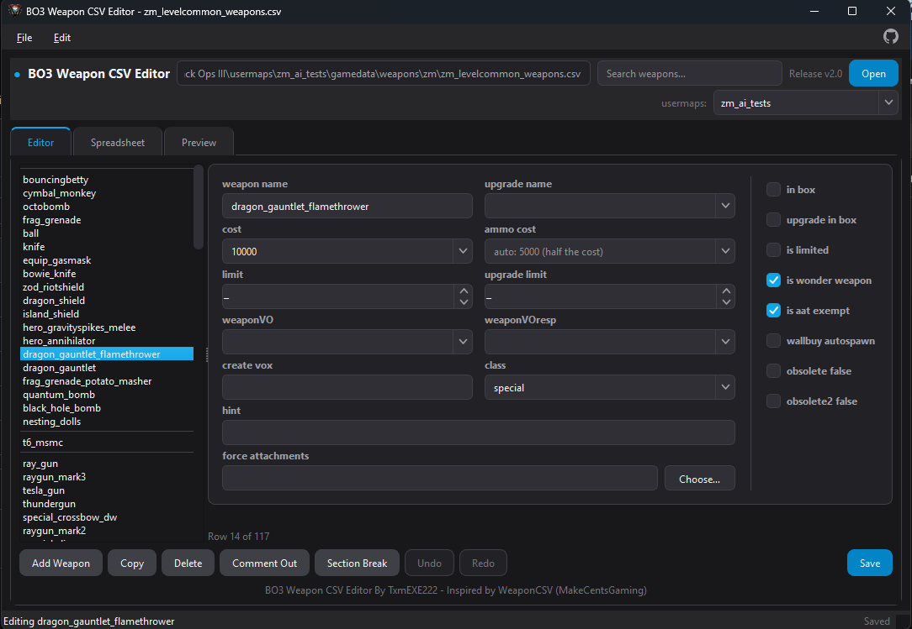
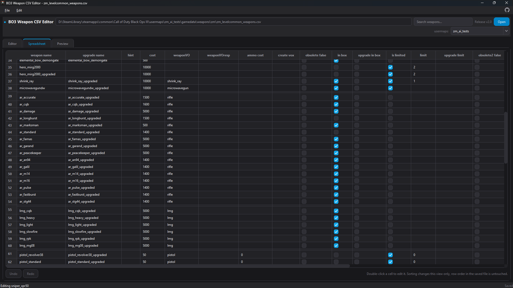
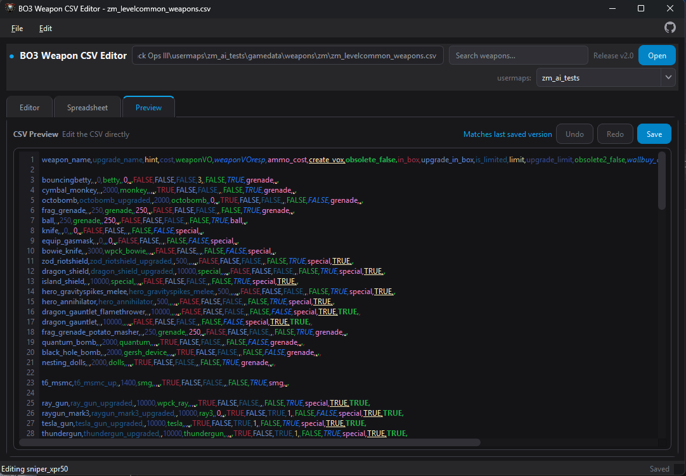

## BO3 Weapon CSV Editor v2

Tool for editing `zm_levelcommon_weapons.csv` in Black Ops III.

Made by TxmEXE222.

## What it does

- Editor tab with every weapon field, checkboxes for the TRUE/FALSE fields, spin boxes for the limits, preset lists for prices, voice lines, class and upgrade names, and a tooltip on each field saying what it actually controls
- Attachment picker for force attachments, grouped by slot, read from the map's attachmentmappingsTable.csv or the stock one
- Spreadsheet tab - edit any cell straight in the grid, sort by any column
- Editable Preview tab with syntax highlighting
- Invalid CSV in Preview shows an error and must be corrected or undone before saving
- Undo and redo across all three tabs
- Add, copy and delete weapons, comment rows out with `//`, drop in section breaks
- `//PISTOLS` style rows show as headings, blank separator lines show as gaps
- Rename a weapon and its `_upgraded` / `_up` / `_rdw_up` name follows
- Search filters the weapon list and the grid at the same time
- Warns about duplicate weapon names when opening a file, editing names, or typing directly in Preview
- Drag a .csv onto the window to open it
- Open starts in your BO3 usermaps folder, found through the mod tools
- usermaps dropdown lists every map and opens its weapons CSV in one click

## Keybinds

| Keys | Action |
|---|---|
| Ctrl+O / Ctrl+S / Ctrl+Shift+S | Open / Save / Save As |
| Ctrl+Z / Ctrl+Y | Undo / Redo |
| Ctrl+N | Add weapon |
| Ctrl+D | Copy weapon |
| Ctrl+Del | Delete weapon |
| Ctrl+/ | Comment out |
| Ctrl+B | Section break |

## Requirements 

Python 3.10+ and PySide6.

Inno Setup 6.3+ (only if you're building the installer)

## Credits and licence

Inspired by WeaponCSV by MakeCentsGaming.

Released under the [MIT licence](LICENSE).
